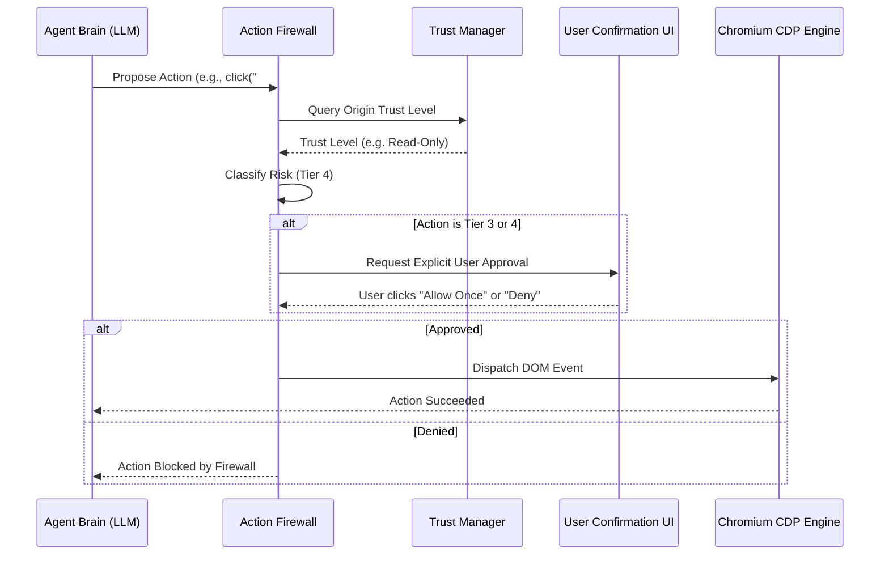

# Action Firewall

The **Action Firewall** is the security backbone of Sentry. It acts as an autonomous gatekeeper between the AI agent's planned steps and actual execution in the browser's Chromium rendering engine.

---

## 4-Tier Risk Classification

Every action proposed by the agent is inspected by the `RiskClassifier` and assigned to one of four risk tiers:

| Tier | Risk Level | Description | Behavior | Examples |
|------|------------|-------------|----------|----------|
| **Tier 1** | **Read-Only** | Passive inspection of public content | Executes automatically | Scroll, read DOM, navigate to trusted public site, extract text |
| **Tier 2** | **Reversible / Low Impact** | Low-risk actions that can be undone | Executes automatically with audit logging | Fill standard search boxes, toggle filters, expand accordions |
| **Tier 3** | **State Modifying** | Changes account or application state | Requires user confirmation prompt | Post a message, submit form data, modify profile settings |
| **Tier 4** | **High Impact / Irreversible** | Financial, security, or permanent operations | Strict confirmation dialog + biometric/password re-auth if configured | Submit order, transfer funds, delete account, export private keys |

---

## How Firewall Interception Works

---

## Action Simulation (Dry Run Mode)

Before running critical multi-step tasks, you can toggle **Dry Run Mode**:
- Sentry evaluates all planned steps against the live DOM without executing modifying clicks or inputs.
- A **Dry Run Report** is presented showing exact selectors, anticipated state changes, and risk ratings.

